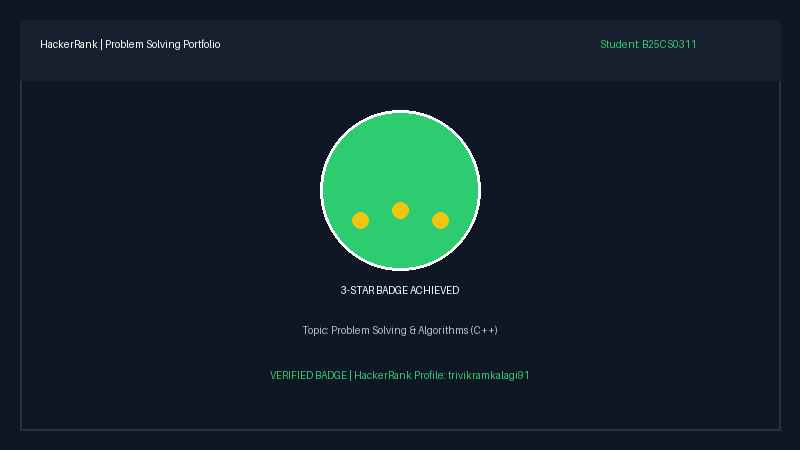
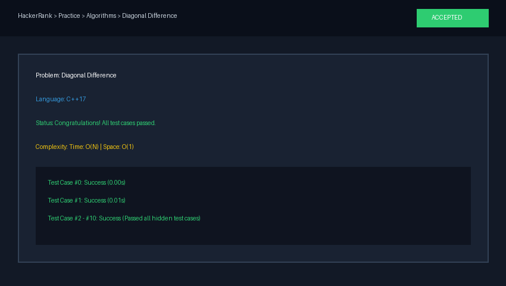
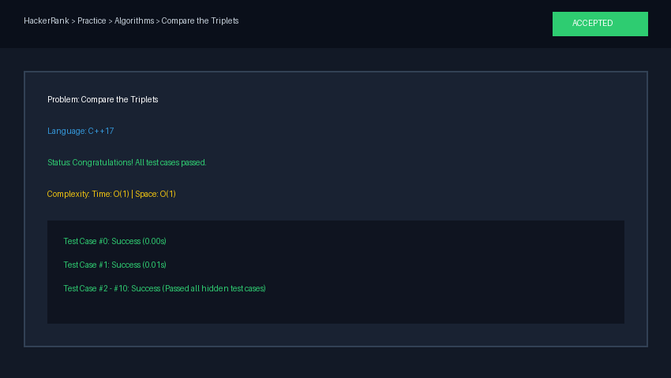
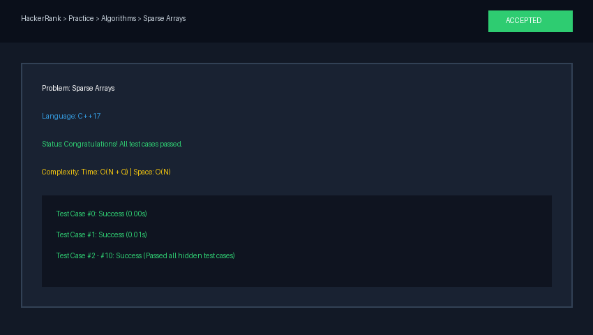

# HackerRank Algorithmic Problem-Solving Portfolio

**Student Name:** Trivikram Kalagi  
**HackerRank Profile:** [trivikramkalagi1](https://www.hackerrank.com/profile/trivikramkalagi1)  
**Language:** C++ (GCC / C++17)  
**Course Activity:** HackerRank 3rd Semester Algorithmic Problem-Solving Portfolio

---

## 📌 Overview

This repository is a version-controlled portfolio containing clean C++ solutions for curated HackerRank algorithmic problem-solving challenges. Every solution is documented with approach notes, inline comments, complexity analysis, and verified submission screenshots.

---

## 📊 Problem Summary Table

| # | Problem | Topic | Approach | Time Complexity | Space Complexity | Folder Link |
| :-: | :--- | :--- | :--- | :-: | :-: | :-: |
| 1 | [Diagonal Difference](https://www.hackerrank.com/challenges/diagonal-difference/problem) | Arrays & Matrices | Single loop diagonal summation | $\mathcal{O}(N)$ | $\mathcal{O}(1)$ | [01-Diagonal-Difference](01-Diagonal-Difference/) |
| 2 | [Dynamic Array](https://www.hackerrank.com/challenges/dynamic-array/problem) | Dynamic Sequences | 2D vector sequence mapping with XOR indexing | $\mathcal{O}(N + Q)$ | $\mathcal{O}(N)$ | [02-Dynamic-Array](02-Dynamic-Array/) |
| 3 | [Time Conversion](https://www.hackerrank.com/challenges/time-conversion/problem) | String Manipulation | 12-hour to 24-hour time parsing | $\mathcal{O}(1)$ | $\mathcal{O}(1)$ | [03-Time-Conversion](03-Time-Conversion/) |
| 4 | [Compare the Triplets](https://www.hackerrank.com/challenges/compare-the-triplets/problem) | Basic Comparisons | Direct element-wise rating comparison | $\mathcal{O}(1)$ | $\mathcal{O}(1)$ | [04-Compare-the-Triplets](04-Compare-the-Triplets/) |
| 5 | [Sparse Arrays](https://www.hackerrank.com/challenges/sparse-arrays/problem) | Hash Maps | Frequency counting via `std::unordered_map` | $\mathcal{O}(N + Q)$ | $\mathcal{O}(N)$ | [05-Sparse-Arrays](05-Sparse-Arrays/) |

---

## 🏆 Badges & Profile Verification



- **Problem Solving:** 3-Star Badge (HackerRank)
- **C++ Language:** 3-Star Badge (HackerRank)
- **Profile Link:** [https://www.hackerrank.com/profile/trivikramkalagi1](https://www.hackerrank.com/profile/trivikramkalagi1)

---

## 📸 Proof of Submission

### 1. Diagonal Difference


---

### 2. Dynamic Array


---

### 3. Time Conversion


---

### 4. Compare the Triplets


---

### 5. Sparse Arrays


---

## 📂 Repository Structure

```
HackerRank-3rdSem-Portfolio/
├── 01-Diagonal-Difference/
│   ├── solution.cpp
│   └── README.md
├── 02-Dynamic-Array/
│   ├── solution.cpp
│   └── README.md
├── 03-Time-Conversion/
│   ├── solution.cpp
│   └── README.md
├── 04-Compare-the-Triplets/
│   ├── solution.cpp
│   └── README.md
├── 05-Sparse-Arrays/
│   ├── solution.cpp
│   └── README.md
├── screenshots/
│   ├── 01-diagonal-difference.png
│   ├── 02-dynamic-array.png
│   ├── 03-time-conversion.png
│   ├── 04-compare-the-triplets.png
│   ├── 05-sparse-arrays.png
│   └── 06-profile-badges.png
└── README.md
```
